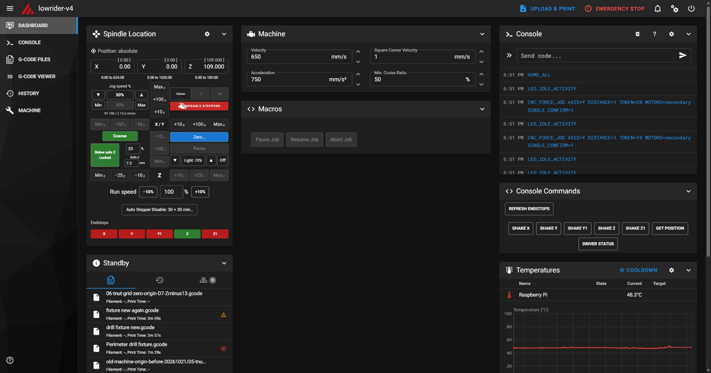
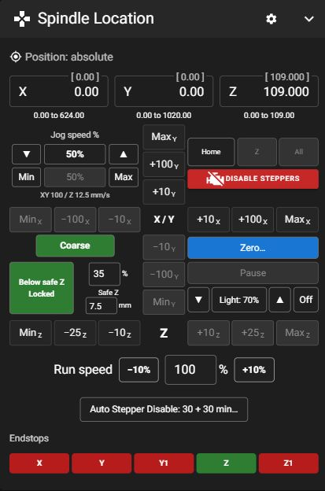
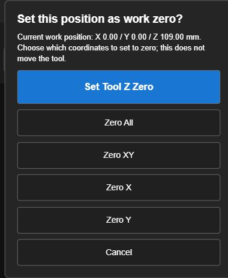
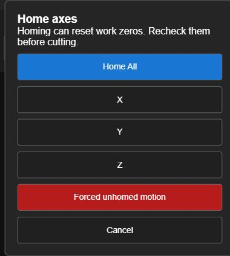
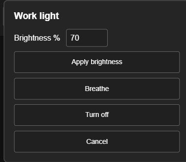
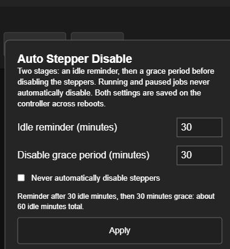

# Mainsail CNC Optimization
### (LowRider V4 specific)

**A CNC dashboard built around the way you actually work at the table.**

🧭 Intuitive jogging · 🛡️ Clearance controls · 💡 Integrated lighting · ⏱️ Stepper reminders

**Mainsail 2.17.0 · Klipper + Moonraker · Desktop + Android**

[The controls](#a-workstation-for-the-spindle) · [Safety boundaries](#know-what-the-guards-cover) · [Recovery](#backup-and-recovery)

## A workstation for the spindle

The familiar printer dashboard becomes **Spindle Location**: a compact control station for moving a router, setting work zeros, managing clearance, and recovering a paused cut.

<table>
<tr><td width="48%" align="center">

</td><td valign="top">

### Less hunting. More useful feedback.

- **X moves horizontally; Y moves vertically.** Small axis labels identify every jog button.
- **Z gets its own horizontal row** beneath the XY controls.
- **Coarse / Fine shows the current mode.** Fine divides the step sizes by ten.
- **Jog speed** accepts direct input, one-point arrows, and Min / 50% / Max shortcuts. Starts at 50%.
- **Actual commanded rates in mm/s** make speed easier to judge; acceleration can limit short moves.
- **Run speed** has direct percentage entry and ±10-point adjustments.
- **Unavailable moves turn gray**, including moves past travel limits.
- **Machine coordinates and remaining work travel** stay visible beside the editable position fields. Press **Enter** to commit a coordinate move; leaving the field cancels the edit.

</td></tr>
</table>

## Clearance is part of the controls

**Safe Z**, **Below safe Z Locked**, and the below-height speed cap live together where jogging happens. Safe height uses the current **work Z**, so it follows your tool/work zero.

Unlocking allows deliberate below-height jogging. Permission resets after moving above the safe height, homing, or changing work zeros. The cap limits speed without changing your selected jog percentage: select 70% with a 30% cap and the display shows **30% (70%)** while capped. A lower selected percentage stays lower.

**Keep-out areas** add table-fixed X/Y rectangles, a machine-Z clearance height, and a margin for tooling or clamps. Three blocks are editable; disabling an active block asks for confirmation. The current machine profile protects the full-width front strip at Y10–110 mm with a 50 mm clearance height and 5 mm margin.

## Work zero deserves a deliberate choice

One **Zero…** button opens a clear choice instead of exposing a row of easy-to-hit zero commands. **Set Tool Z Zero** is first and highlighted for tool setup, followed by **Zero All**, **Zero XY**, **Zero X**, and **Zero Y**. Cancel is always available. These actions change the work reference; they do not move the tool or measure tool length automatically.

## Homing and recovery, in their own space

The compact row provides **Home**, **Z**, and **All**. The dialog holds axis-specific homing and the advanced recovery option. Already-homed axes are disabled, and homing/stepper-disable controls are unavailable while a job is running or paused. Homing turns the work light on at 70% before motion. Recheck work zeros after homing.

**Forced unhomed motion** is deliberately tucked inside Home. After acknowledgement, unknown axes use flashing red **±0.1 / ±1 mm** buttons at **1 mm/s**, one move at a time. Homed axes retain normal controls and limits. Dual Y and Z motors can be selected independently for alignment: **yellow Move**, **red Hold**, with an additional acknowledgement for single-motor motion. Mode exits on homing, disabling steppers, job activation, restart, or manual cancellation; it never stays enabled across reboot.

## Light where you need it

The grid reports **Light: 70%**, **Max**, **Off**, or **Breathe** before you touch it. Arrows adjust brightness by ten percentage points. A separate **On / Off** toggle stays useful in both states; On uses 70%. The center button opens brightness entry and optional manual breathing. When the idle warning is active, its first press becomes **Snooze idle warning** for fifteen minutes.

## A reminder before releasing the motors

**Auto Stepper Disable** uses two saved settings:

| Stage | Default | What happens |
|---|---:|---|
| Idle reminder | 30 minutes | Three rapid light flashes, then one second steady, repeating; Disable Steppers flashes on screen. |
| Disable grace period | 30 more minutes | With no further activity, and no running or paused job, disable the steppers. |
| Snooze | 15 minutes | Acknowledge the reminder and defer it. |

Reminder, grace period, and the **Never automatically disable steppers** option survive controller reboots. Dashboard activity resets the automatic reminder. The current light-based warning/disable sequence requires steady work-light brightness above zero; turning the light off suppresses it. The machine's separate Klipper idle timeout only turns heaters off and does not impose a four-hour motor cutoff.

## Job controls that say what they do

**Pause Job · Resume Job · Abort Job** replace ambiguous macro names. The grid's Pause / Resume uses the same underlying operations as the job buttons. Pause captures XY and the available file progress information; paused jogging lets you access the workpiece before an ordered return. Abort is the normal job-cancel operation, so previously queued motion can finish. The emergency stop remains a separate control. Router power is manually controlled on this machine.

**Console Commands** groups Refresh Endstops, individual motor shake tests, position reporting, and driver status. Endstop badges show **green = open**, **red = triggered**. They refresh after dashboard motion or an explicit refresh, rather than continuously polling and making the job panel flicker.

## Know what the guards cover

These are **dashboard jog safeguards**, not a replacement for a verified toolpath or a hardware stop. The safe-height prompts and keep-out blocks do not police G-code jobs, arbitrary console commands, or homing. Forced recovery has no known travel reference on an unhomed axis; its small steps and low rate cannot establish where the physical limits are. Individual-motor moves can rack or tilt the gantry.

This profile is specific to this machine: **X 0–624, Y 0–1020, Z 0–109 mm**, SKR V1.4 wiring, dual Y/Z motors, and a light on P2.7. Do not copy its machine configuration to another CNC without adapting it.

## Backup and recovery

This private repository keeps the machine configuration separate from the X5SA backups. Official **[Klipper-Backup](https://github.com/Staubgeborener/klipper-backup)** handles the Git history and upload. A small preparation step includes the files outside the normal Klipper config folder:

| Saved component | Why it matters |
|---|---|
| Klipper configuration and saved variables | Wiring, travel, macros, work-light logic, reminder/grace settings |
| Mainsail overlay + loading page | The complete CNC interface |
| Custom forced-jog controller extension | Constrained unhomed recovery controls |
| Selected Moonraker database namespaces | Dashboard groups/layout and keep-out areas |
| Versions and SHA-256 manifest | Identify the software revision and verify recovery files |
| These screenshots and recovery guide | Show the expected result and explain restoration |

The schedule checks **every 15 minutes** and commits only changed content; failed uploads retry on a later check. This is a configuration backup, not a full SD-card image: G-code jobs, videos, logs, network credentials, private keys, and authorization data are excluded. Browser-local choices such as Safe Z and jog cap must be rechecked on a new device.

See **[RESTORE.md](lowrider-backup-docs/RESTORE.md)** for paths, integrity checks, settings import, and backup maintenance. Mainsail upgrades can replace the loading page or change selectors; Klipper upgrades can affect the custom controller extension. Test compatibility before relying on either after an upgrade.

---

Built around real CNC setup, testing, and iteration on a LowRider V4. Based on **[Mainsail](https://github.com/mainsail-crew/mainsail)**, **[Moonraker](https://github.com/Arksine/moonraker)**, and **[Klipper](https://github.com/Klipper3d/klipper)**. This is a machine-specific customization and recovery archive; it is not yet a general-purpose installer or public release.
